# ClaimPack – User Guide

For app version 0.5.0 (beta). In the app, **Help** (top right) has a short version of this guide and what's new. **Open the app:** the link shared in your team's WhatsApp group, or scan the QR code on a colleague's phone (**Help → Share this app**).

The names, project, merchants and amounts in the screenshots are samples.

**Contents:** [Month-end in 6 steps](#month-end-in-6-steps) · [1. Install](#1-install) · [2. Claim details](#2-claim-details) · [3. Add your receipts](#3-add-your-receipts) · [4. Check](#4-check) · [5. Claim form](#5-admin-27-form) · [6. Build the PDF](#6-build-the-pdf) · [7. What the PDF looks like](#7-what-the-pdf-looks-like) · [8. Print and hand in](#8-print-and-hand-in) · [9. Records, Setup and backup](#9-records-setup-and-backup) · [10. Share the app](#10-share-the-app) · [11. Good to know](#11-good-to-know)

## Month-end in 6 steps

1. **Claim details**: month, your name, project and the claim types you are claiming.
2. **Add item** for each receipt: date, merchant, amount (for fuel: litres and price; the amount works itself out).
3. **Attach** the receipt, its e-invoice and any other support, then tick *I checked*.
4. Look at **Summary & checks**: everything green, no warnings.
5. **Check claim form**: it is already filled in; add outstation trip details if you have any.
6. **Generate PDF** → page through → **Share** / **Save** / print at A4 actual size. Sign the claim form, staple the original receipts behind **Appendix A**, hand it in.

The strip near the top (**Details · Receipts · Review · Export**) shows where you are. Tap a step to jump to what still needs doing.

## 1. Install

The app runs in the phone's browser; there is nothing to download from an app store.

1. Open the app link.
2. Add it to the home screen:
   - **iPhone (Safari):** Share → *Add to Home Screen*.
   - **Android (Chrome):** menu ⋮ → *Install app* or *Add to home screen*.
   - **Laptop:** open the link in Chrome or Edge and bookmark it.
3. Open it from the home-screen icon. After the first visit it also works without signal.

## 2. Claim details

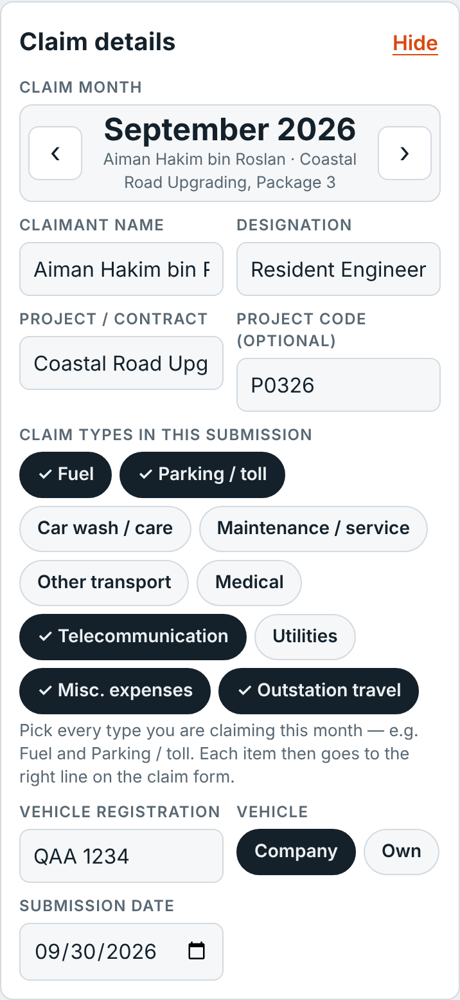

- **Claim month**: use **‹ ›**.
- **Claimant name** and **Designation**: as printed on the form.
- **Project / contract** and **Project code** (optional): the code is printed after your name on the claim form, e.g. *AIMAN HAKIM BIN ROSLAN (P0326)*.
- **Claim types in this submission**: tap every type you are claiming this month. Each type goes to its own line on the claim form:

| Claim type | form line |
|---|---|
| Fuel | 1a |
| Car wash / care | 1b |
| Maintenance / service | 1c |
| Parking / toll | 1d |
| Other transport | 1e (what it was is printed beside it) |
| Medical | 2 |
| Telecommunication | 3 |
| Utilities | 4 |
| Misc. expenses | 5a, 5b, 5c (one line per description) |
| Outstation travel | 6a, 6b, 6c (one block per trip) |

- **Vehicle registration** and **Company / Own**: shown when you claim fuel or other transport; ticked on the form.
- **Submission date**: printed beside *Submitted by*.

Once the details are filled in and you have items, the panel folds into one line; tap **Edit** to open it again.

## 3. Add your receipts

**One item per receipt.**

- **＋ Add item**: a new, empty item opens. If you picked more than one claim type, choose it first under **New item type**.
- **Scan receipt**: opens the receipt scanner (below) and makes the photo the receipt of a new item.
- **Add several receipts at once**: pick many photos or PDFs; each becomes an item with its receipt attached. Then open each one and key in the details.
- **On a computer**: drag photos and PDFs onto the page. Dropped anywhere, each file becomes a new item; dropped on an item, it is attached there (a PDF goes to the e-invoice box); dropped on a *Receipt*, *E-invoice* or *Other* box, it goes into that box.

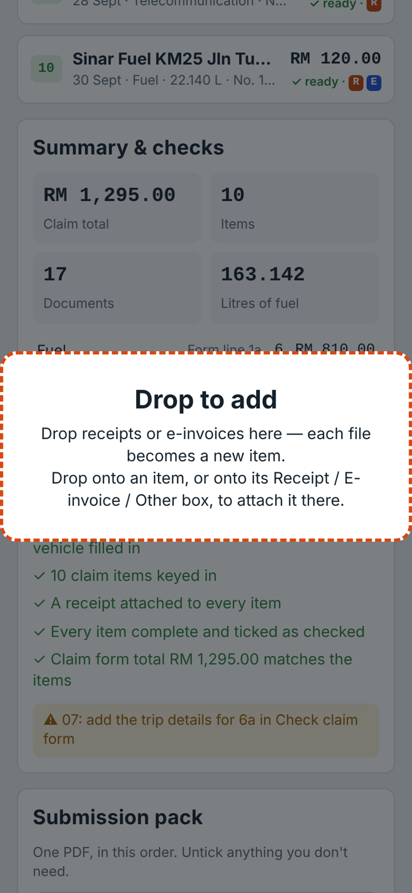

**The receipt scanner**

1. Lay the receipt flat on a darker surface (a table, a folder). The scanner outlines it; tap the round button. (If the live camera is not available, the phone's camera app opens instead.)
2. Drag the four corners to the edges of the receipt if needed. **Whole photo** keeps everything. Then **Next ›**.
3. Choose **B&W** (sharpest, best for printing), **Grey**, **Colour** or **Original**; **⟳** rotates; **Corners** goes back. Then **Use photo**.

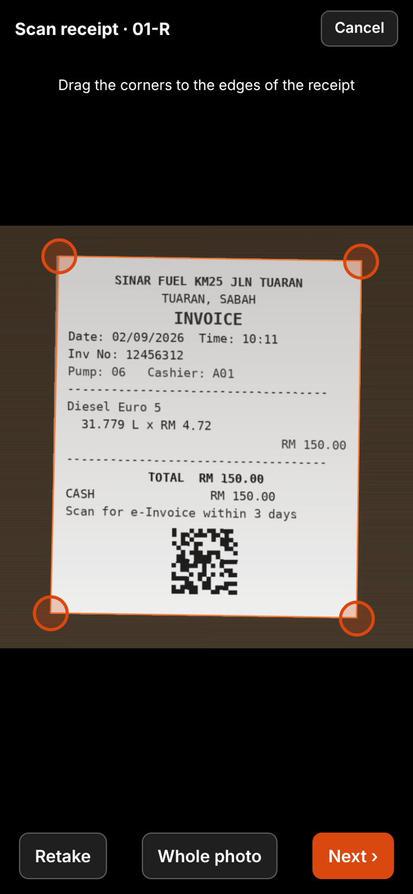&nbsp;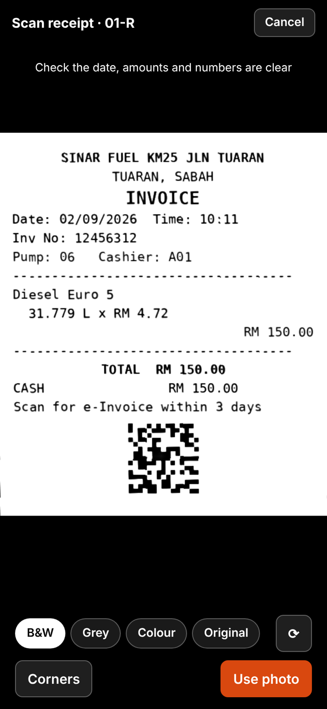

Long receipts are fine — the copy keeps the receipt's own length. **Crop** on an attached photo opens the same steps for a photo you added earlier.

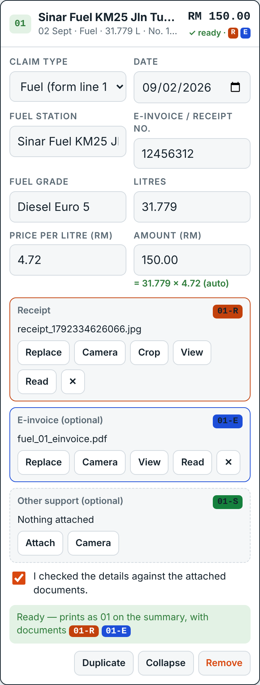

**Key in:**

- **Date**, **merchant / station**, **invoice or receipt no.** and a short **description** (for fuel: the grade, e.g. *Diesel Euro 5*).
- **Fuel:** key in **Litres** and **Price per litre**; the **Amount** fills in (*= 31.779 × 4.72 (auto)*). If the receipt shows a different amount (the pump rounds), type it in; the app keeps your amount and shows the litres × price figure with **Use this** in case you want it back. Typed only the amount and price? **Fill litres** works the litres out.
- **Other types:** quantity and unit price are optional; if you key them in, the amount is worked out the same way.
- **Outstation travel:** also pick the **trip** (6a, 6b or 6c) and the **form column** (Air Ticket, Hotel, Fares, F & B, Parking / Toll, Fuel (Mileage), Others).

**Attach** (each box shows the reference the document will carry in the PDF, in its colour):

- **Receipt / bill** (needed) — **01-R**, orange
- **E-invoice** (optional) — **01-E**, blue
- **Other support** (optional), e.g. an approval memo or a statement — **01-S**, green

Use **Attach** (photo or PDF from the phone), **Camera** (the scanner) or drag a file onto the box. **Crop** straightens a photo, **View** opens it, **✕** removes it. **Read** suggests the date, number and amount from the document — untick anything wrong, then **Apply**. Always compare with the document.

The same colours are used on the printed pack, so a checker can match a receipt to its e-invoice at a glance. A folded item shows small R / E / S tags for the documents it has.

Then tick **I checked the details against the attached documents**. The item shows **✓ ready**.

**Items are numbered by date** (01 is the earliest). The number is the same on the summary, the index and every attached page. **Duplicate** copies an item (same station and type) for the next refuel; **Collapse** folds it up; **Remove** deletes it with its documents.

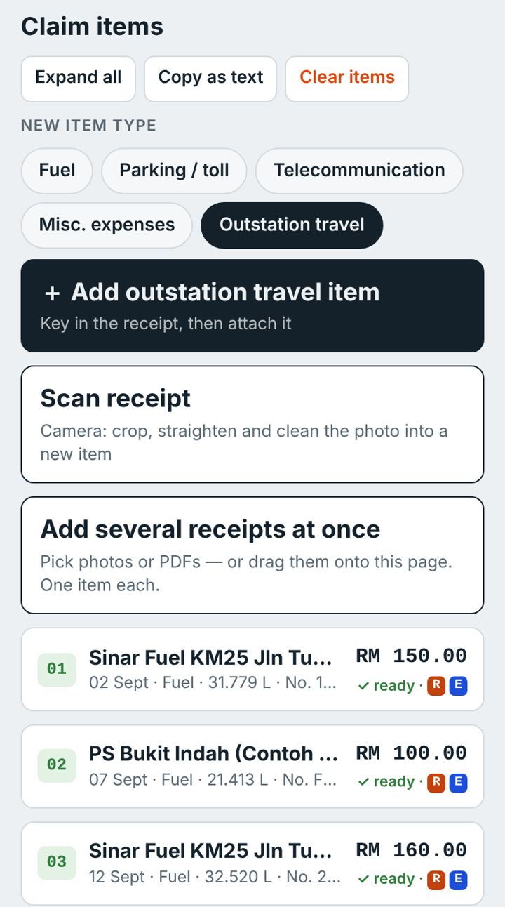

**Copy as text** puts a short list of the items on the clipboard to paste into WhatsApp with the PDF. **Expand all** opens every item.

## 4. Check

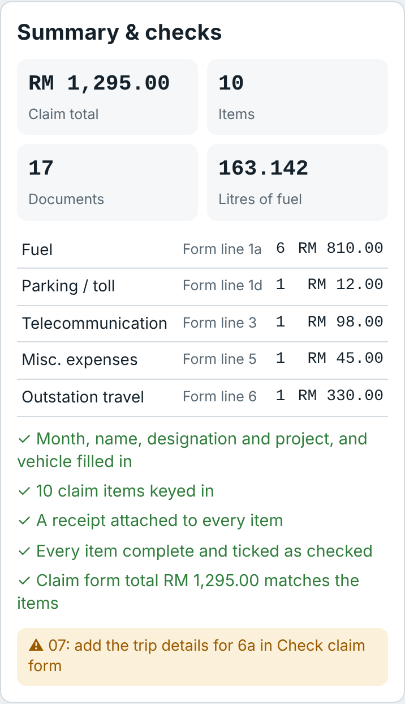

**Summary & checks** shows the total, items, documents, litres of fuel and the amount for each claim type with its form line. The checks turn green when:

- the month, name, designation, project (and vehicle, for fuel) are filled in,
- every item has a receipt,
- every item is complete and ticked,
- the claim form total matches the items.

**Warnings** (orange) point at things to look at, using the item numbers: a receipt dated outside the claim month, two items with the same invoice no., an amount that differs from quantity × price, an outstation item whose trip details are still empty.

## 5. Claim form

Tap **Check claim form** in the *Submission pack* panel.

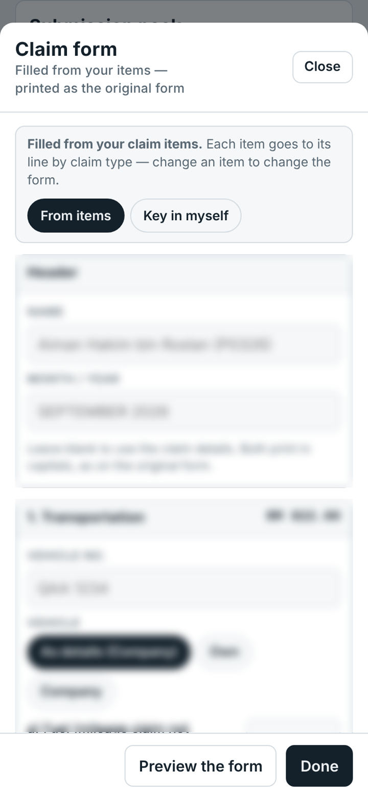&nbsp;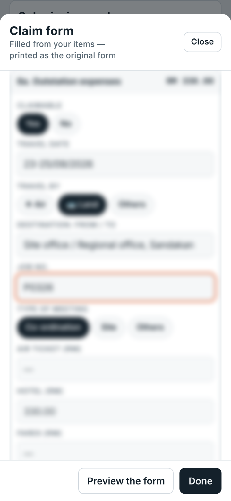

- **From items** (default): the amounts come from your items, line by line. To change a figure, change the item.
- **Key in myself**: the amounts become editable boxes, starting from the current figures. They no longer follow the items — the checks tell you if the form total and the items differ.
- **Header**: leave *Name* and *Month / year* blank to use the claim details. Both print in capitals.
- **Vehicle**: *As details* uses the claim details; or tick *Own* / *Company* for this form only.
- **Outstation 6a–6c**: open the trip and fill in **Claimable**, **Travel date**, **Travel by** (✈ air, 🚌 land, others), **Destination from / to**, **Job no.** and **Type of meeting**. The amounts come from the outstation items for that trip.
- **Signature block**: tick to print your name and the submission date at *Submitted by*; untick to sign and date by hand. *Checked by* and *Approved by* are left for the checker and approver.
- **Preview the form** shows the page as it will print.

The printed page follows the original form: the same layout, lines, tick boxes, fonts and note. The person the note asks you to pass the claim to is set in **Setup → claim form note line**.

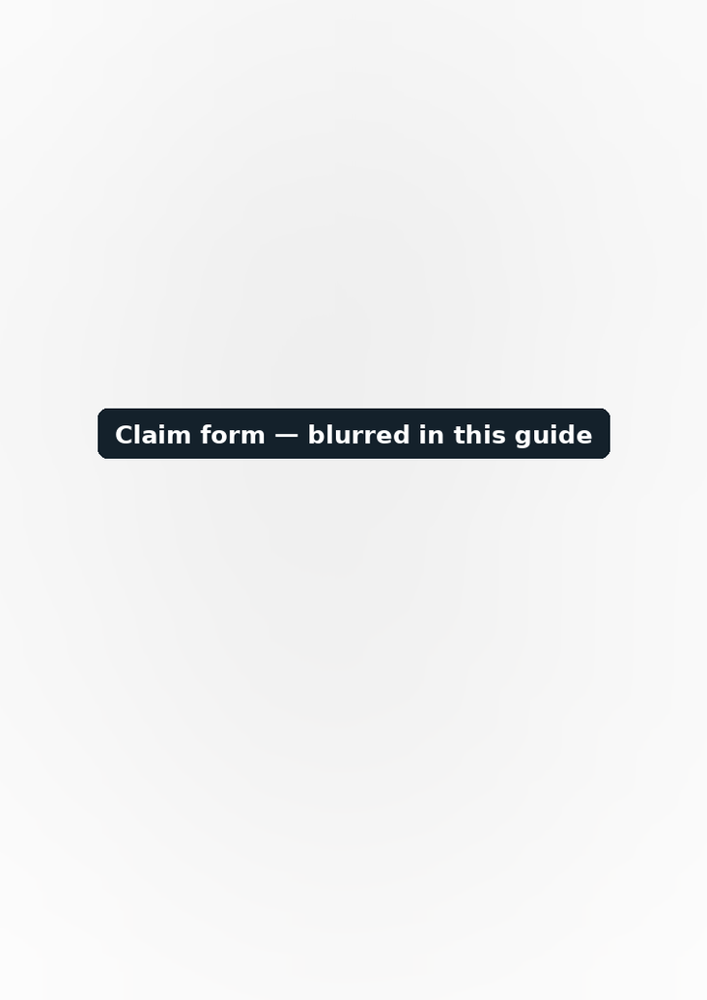

## 6. Build the PDF

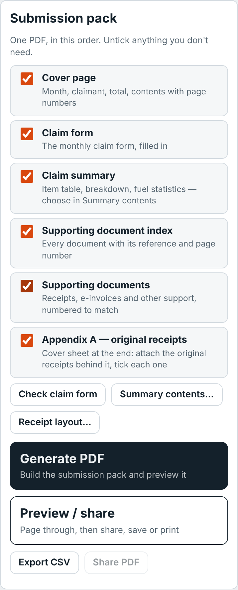

1. Under **Submission pack**, untick any part you don't need: *Cover page*, *Claim form*, *Claim summary*, *Supporting document index*, *Supporting documents*, *Appendix A — original receipts*.
2. **Summary contents…** chooses what the summary shows (below).
3. **Receipt layout…** chooses how the documents are arranged, and the QR on the cover (below).
4. **Generate PDF** (or the orange button at the bottom). The preview opens.
5. Page through with **‹ Previous / Next ›**, or jump with the section buttons (*Cover · p.1*, *claim form · p.2* …).
6. **Share PDF** (WhatsApp, e-mail, Drive), **Save**, or **Open to print**. Print on A4 at **actual size (100%)**.

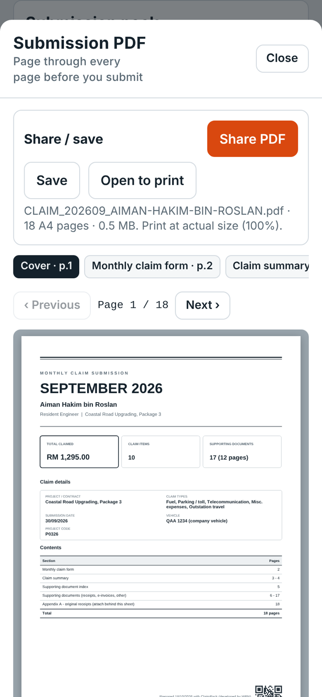

**Summary contents**

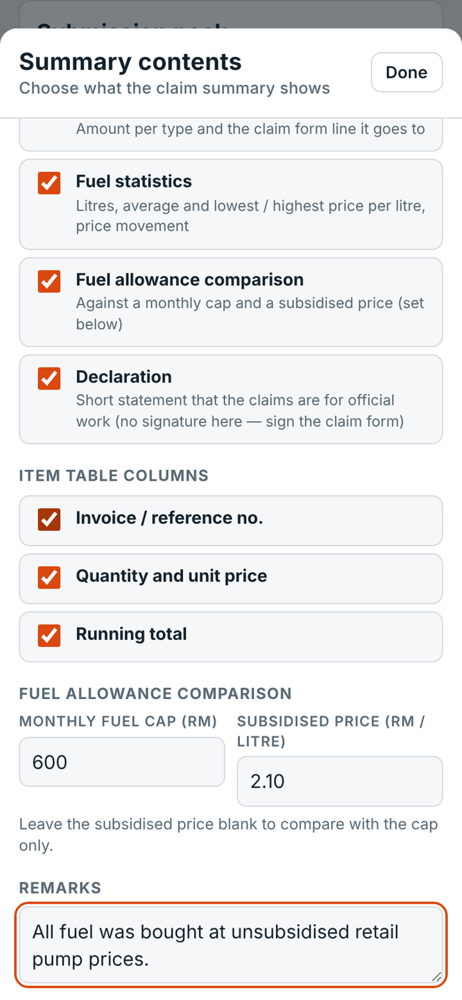

- **Sections:** claim details, claim items table, breakdown by claim type, fuel statistics, fuel allowance comparison, declaration. The summary has no signature block — it is generated from your entries; you sign the claim form.
- **Item table columns:** invoice / reference no., quantity and unit price, running total.
- **Fuel allowance comparison:** set the **monthly fuel cap** and, if you want the comparison, the **subsidised price per litre**. The summary then shows the total as a % of the cap, the amount over the cap, the litres the cap buys, and the extra cost against the subsidised price.
- **Remarks:** a note printed on the summary, e.g. *All fuel was bought at unsubsidised retail pump prices.*

**Receipt layout**

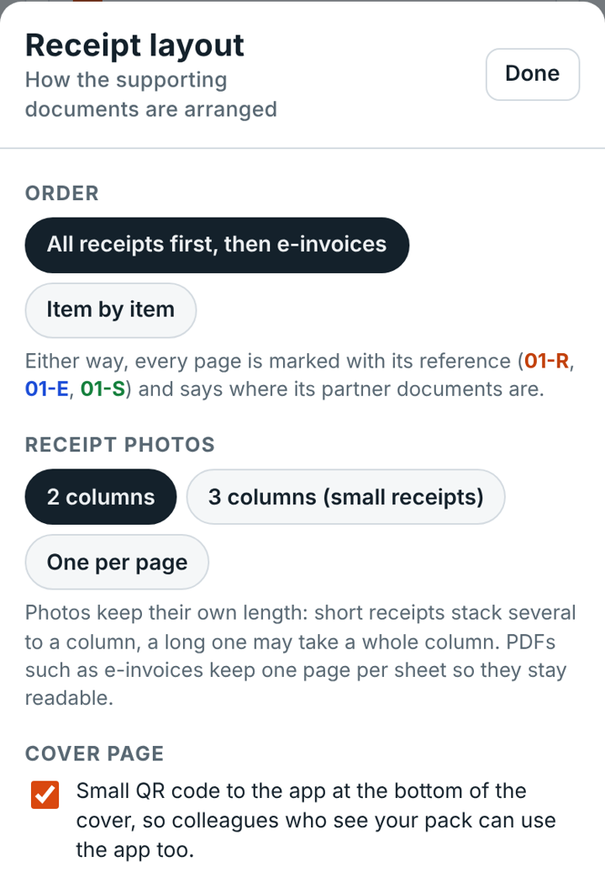

- **Order:** *All receipts first, then e-invoices* (like a usual hand-made pack), or *Item by item* (each receipt followed by its e-invoice).
- **Receipt photos:** **2 columns** (default), **3 columns** (for small receipts) or **One per page**. Each photo keeps its own length and goes into the shortest column, so several short receipts share a column and a long one can take a whole column. PDF documents (e-invoices, bills) keep one page per sheet so they stay readable.
- **Cover page:** a small QR code to the app at the bottom right of the cover (on by default) — colleagues who see your pack can scan it to use the app.

**Export CSV** saves the items as a spreadsheet file (with the item numbers and document references).

## 7. What the PDF looks like

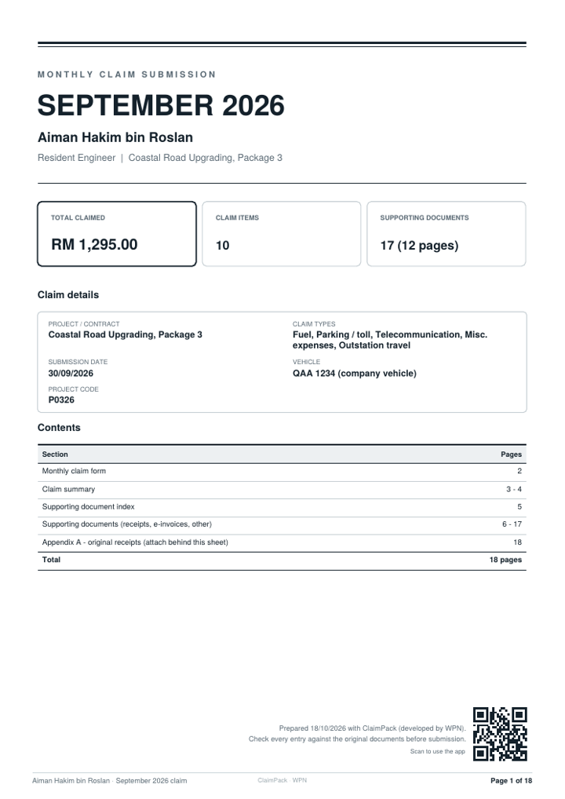&nbsp;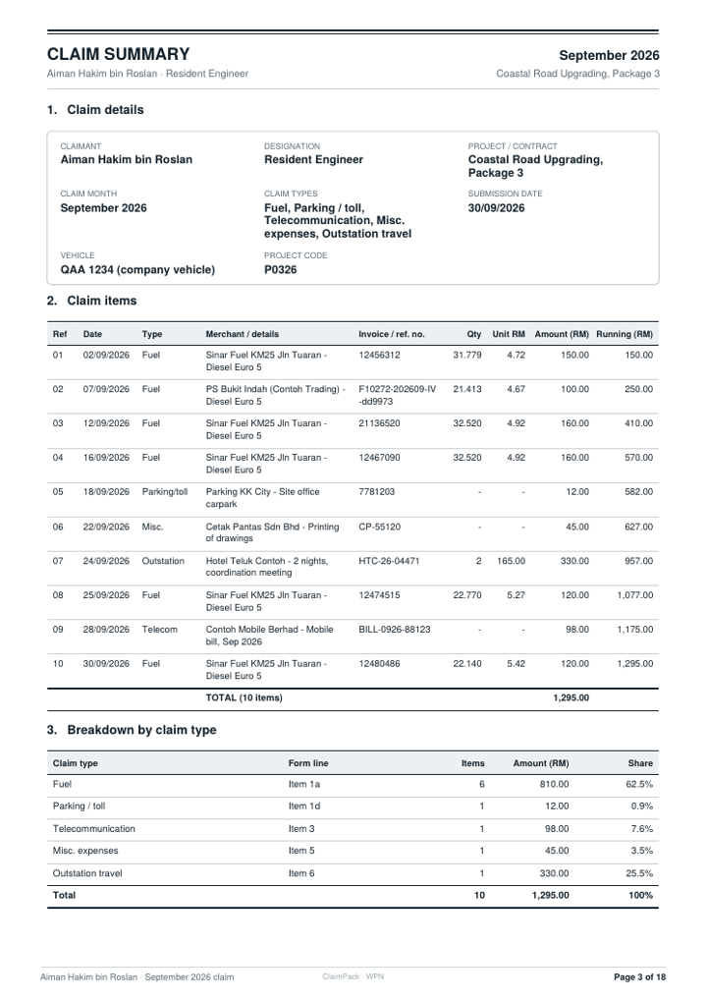

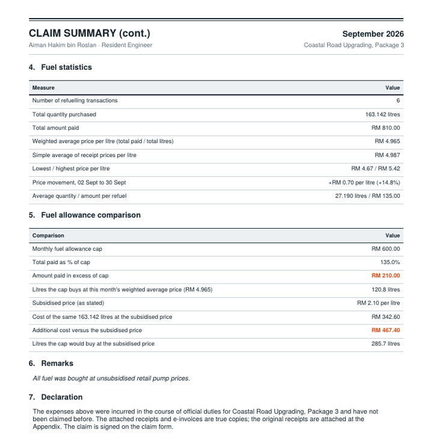&nbsp;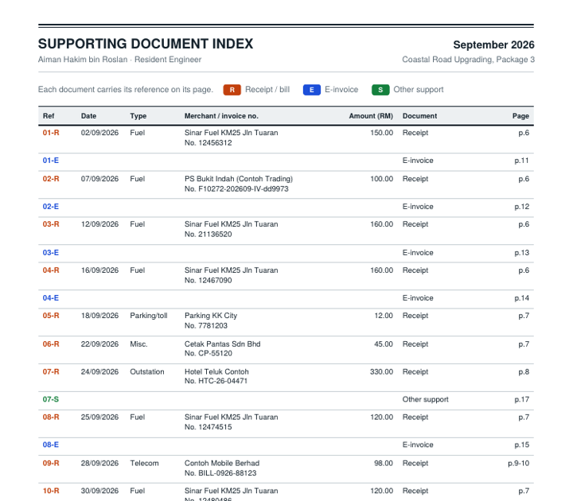

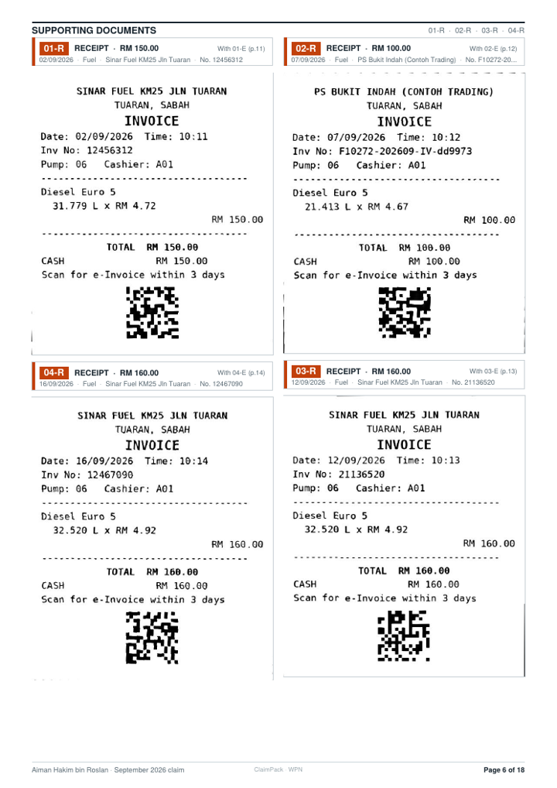&nbsp;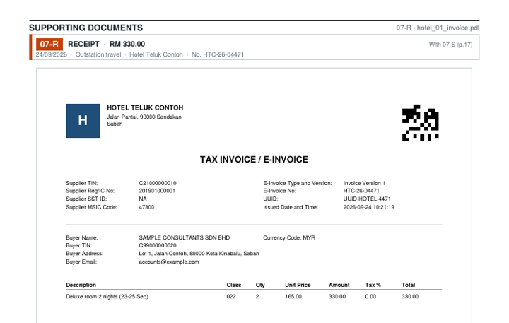

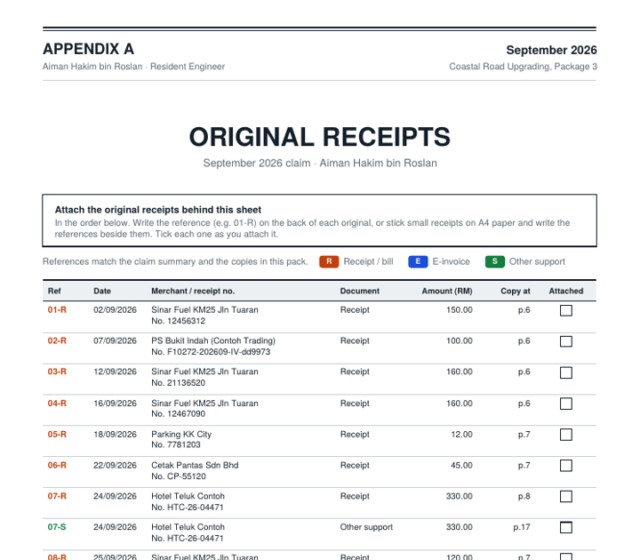

- **Cover**: the month, your name, total claimed, number of items and documents, claim details, and the contents with page numbers.
- **Claim form**: as section 5.
- **Claim summary**: the sections you chose.
- **Supporting document index**: each item with its documents and the pages they are on.
- **Supporting documents**: every document has a caption with its colour-coded reference (**01-R**), the kind of document, the date, merchant, amount, and where the partner documents are (*With 01-E (p.11)*).
- **Appendix A — original receipts**: the last page. It lists every receipt and other support with its reference, the page of its copy, and a tick box.
- Every page except the claim form has a footer: your name and month, and *Page x of y*.
- The pack is made for black-and-white printing: no coloured blocks, only the small coloured references.

## 8. Print and hand in

1. Print the PDF on A4 at **actual size (100%)**. Black and white is fine; colour only helps the references stand out.
2. **Sign the claim form** (*Submitted by*) — if you ticked *Print my name and the submission date*, they are already there.
3. Staple the **original receipts** behind **Appendix A**, in the order listed. Write the reference (e.g. *01-R*) on the back of each one, or stick small receipts on an A4 sheet with the reference beside each. Tick each one as you go.
4. Hand in the pack. Keep the PDF (Share → Drive or e-mail) as your copy.

## 9. Records, Setup and backup

**Records** (top right, or tap the month badge at the top left) lists your claims.

- **＋ Next month's claim** starts the next month with your name, designation, project, claim types and vehicle copied; the items start empty. **Start next month from this** does the same from any claim.
- **Blank claim** starts from nothing. **Open** switches claim; **Delete** removes a claim and its documents from the phone.

**Setup** (top right):

- **Feedback**: send a problem or an idea on WhatsApp; the app version and your phone type are filled in.
- **Claim form note line**: who checks the claims, printed in the note on the form: *Kindly pass to … for checking purposes.* It is filled in already; change it only if your office uses someone else.
- **Backup**: **Export backup file** saves every claim and document to one file — keep it in Drive or e-mail it to yourself. **Restore from backup** loads it on a new phone (it replaces the claims on that phone).
- **AI scan (Gemini, optional)**: paste a free API key to read handwriting and faded receipts. The key stays on the phone; a document is sent to Google only when you tap **Read**. Without a key the offline scanner is used.
- **Appearance**: Auto, Light or Dark.
- **Delete data on this phone**: removes everything (save a backup first).
- **About**: version and **Share this app**.

## 10. Share the app

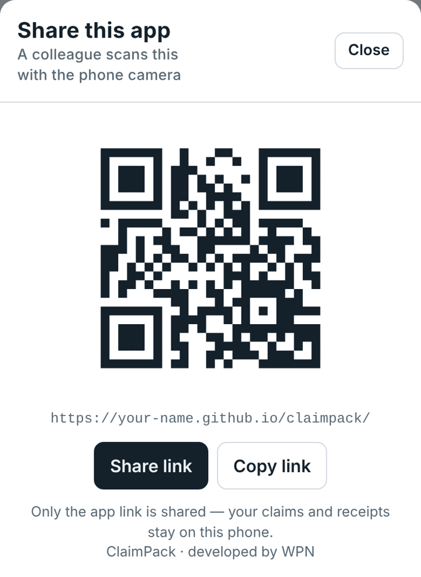

- **In the app:** **Help → Share this app** (also in Setup and at the bottom of the main screen) shows a QR code a colleague scans with the phone camera, plus **Share link** and **Copy link**. Only the app link is shared, never your claims.
- **On the pack:** the small QR at the bottom right of the cover takes anyone who sees a printed or shared pack — checkers, admin, other teams — to the app.
- **For a team:** put the link and the QR in the team's WhatsApp group description and in the claim instructions from the admin office.

## 11. Good to know

- **Everything stays on your phone** until you share the PDF. There is no account and no server. Clearing the browser's data deletes your claims — keep a backup.
- **Photos**: use **Scan receipt** / **Camera** — the scanner straightens and cleans the photo. Good light, the receipt flat on a darker surface. Faded thermal receipts: try **Grey**. iPhone photos saved as HEIC: use the app's scanner, or set the camera to *Most Compatible*.
- **PDF size**: photos are reduced to print quality, so a month with 10–20 receipts is usually under 2 MB — small enough for WhatsApp and e-mail.
- **Read** and **AI scan** only suggest values. You are responsible for what you claim; follow your company's claim policy and hand in the originals it asks for.
- **New version**: when one is published, a green bar appears — tap **Update now**.

ClaimPack is developed by **WPN**.
